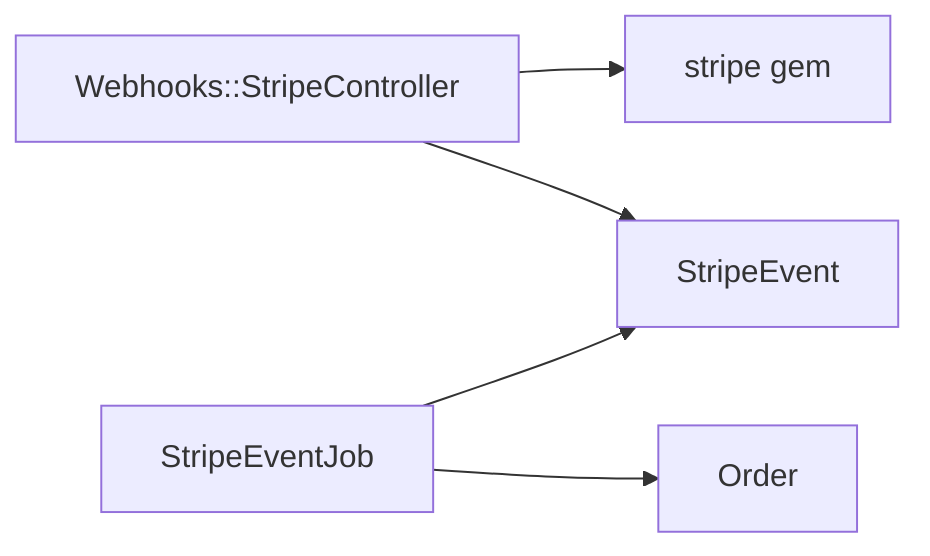

You are acting as the `design-adversary` agent. Its definition is at
`agents/design-adversary.md` in this repo — read it and follow it exactly.

Review the plan below. Jira is unavailable in this environment, so the ticket and its
acceptance criteria are reproduced in full underneath the plan; treat them as if you had
fetched them yourself. The ticket's parent Epic, ABC-300, is reproduced after it. The
repository the plan describes is not present either, so treat the plan's factual claims
about existing code as verified — you cannot grep for what is not here, and a claim you
cannot check is `UNVERIFIABLE`, not a `BLOCKER`. The project the plan belongs to — not this
repository — has `security` in its `disciplines`, so the plan carries a `Threat model`.

Return findings in the format the agent definition specifies.

---

# ABC-301 — Receive Stripe payment webhooks

## Scope

What ships: an endpoint that receives Stripe's `payment_intent.succeeded` and
`payment_intent.payment_failed` webhooks, verifies each one, and records it, so an order's
payment state no longer depends on the nightly reconciliation job.

What explicitly does not ship: other Stripe event types, which are acknowledged with a 200
and dropped, and any change to the nightly reconciliation job, which stays as a backstop.

Covering ticket: ABC-301.

## Acceptance criteria coverage

| ID | Ticket | AC | Phase | Verified by | Deviation |
| --- | --- | --- | --- | --- | --- |
| AC1 | ABC-301 | A webhook with a valid `Stripe-Signature` is recorded | 2 | `spec/requests/webhooks/stripe_spec.rb:records_signed_event` | — |
| AC2 | ABC-301 | A webhook with a missing or invalid signature is rejected with a 400 | 1 | `spec/requests/webhooks/stripe_spec.rb:rejects_bad_signature` | — |
| AC3 | ABC-301 | A webhook whose timestamp is more than 5 minutes old is rejected with a 400 | 1 | `spec/requests/webhooks/stripe_spec.rb:rejects_replayed_event` | — |
| AC4 | ABC-301 | An event delivered twice is recorded once | 2 | `spec/models/stripe_event_spec.rb:unique_event_id` | — |
| AC5 | ABC-301 | A recorded success marks its order paid | 2 | `spec/jobs/stripe_event_job_spec.rb:marks_order_paid` | — |

## Approach

Surveyed: Stripe's own webhook guide (verify the `Stripe-Signature` HMAC over the raw body
with the endpoint secret, reject a timestamp outside a tolerance, return 2xx fast and
process asynchronously, and dedupe on the event ID because delivery is at-least-once),
GitHub's webhook guide (`X-Hub-Signature-256` HMAC over the raw body, compared in constant
time, and the same respond-fast advice), and Shopify's (`X-Shopify-Hmac-Sha256`, same
shape). All three put verification on the raw body before parsing and processing behind a
queue. This plan follows Stripe's guide, since Stripe is the sender: the `stripe` gem's
`Stripe::Webhook.construct_event` verifies the signature and the 300-second tolerance.

In-repo precedent: `app/controllers/webhooks/github_controller.rb:14` verifies GitHub's
HMAC over `request.raw_post` and enqueues a job. This plan follows it.

## Components and interfaces

### Webhooks::StripeController (new, `app/controllers/webhooks/stripe_controller.rb`)

- Responsibility: verify an inbound Stripe webhook and record it.
- Inputs: an unauthenticated POST from the internet with a `Stripe-Signature` header and a JSON body.
- Outputs: a 200 once the event is recorded and its job enqueued.
- Errors: a missing, invalid, or stale signature returns a 400 and records nothing.
- Versioning: the endpoint pins the Stripe API version in the dashboard; a new version is a new endpoint secret.
- Layer: presentation

### StripeEvent (new, `app/models/stripe_event.rb`)

- Responsibility: hold each verified event once.
- Inputs: the event ID, type, and payload from the controller.
- Outputs: the stored row, read by `StripeEventJob`.
- Errors: a duplicate event ID violates the unique index; the controller treats that as already recorded and returns a 200.
- Versioning: the payload is stored as JSON, so new fields need no migration.
- Layer: data access

### StripeEventJob (new, `app/jobs/stripe_event_job.rb`)

- Responsibility: apply a recorded event to its order.
- Inputs: a `StripeEvent` ID.
- Outputs: the order's payment state updated.
- Errors: an event naming an unknown order is logged and left unapplied; the nightly reconciliation catches it.
- Versioning: unknown event types are ignored.
- Layer: domain logic

## Likely changes

- The set of handled event types — hidden behind `StripeEventJob`.

## Data ownership

| Store | Owning module |
| --- | --- |
| `stripe_events` table | `StripeEvent` |
| `orders.payment_state` | the `Order` model, unchanged; this plan writes it through `Order#mark_paid!` |

## Test strategy

| Level | Risks covered |
| --- | --- |
| unit | Duplicate event IDs in `spec/models/stripe_event_spec.rb`; order updates in `spec/jobs/stripe_event_job_spec.rb` |
| integration | Signature, staleness, and the 200 in `spec/requests/webhooks/stripe_spec.rb` |
| system | none — Stripe's test-mode CLI delivery is a manual check, not a suite |
| acceptance | The five ACs, each named in the coverage table |

Coverage target: 100% branch coverage of the controller, model, and job.

## NFR coverage

| Ticket | NFR | Design element |
| --- | --- | --- |
| — | — | none — ABC-301 and its parent Epic ABC-300 carry no NFR lines |

## Threat model

`Webhooks::StripeController` is the only component handling external input; the model and
the job read rows the controller has already verified.

| Component | Category | Rating | Mitigating phase |
| --- | --- | --- | --- |
| Webhooks::StripeController | Spoofing | High | 1 |
| Webhooks::StripeController | Tampering | High | 1 |
| Webhooks::StripeController | Repudiation | Medium | 2 |
| Webhooks::StripeController | Information disclosure | Low | — |
| Webhooks::StripeController | Denial of service | High | — |
| Webhooks::StripeController | Elevation of privilege | Low | — |

Spoofing and tampering: the signature check in Phase 1. Repudiation: each event's ID and
payload are stored in Phase 2. Information disclosure: the response body is empty.
Denial of service: the endpoint is public and unauthenticated, and every request runs an
HMAC over its whole body before it can be rejected.

## Rejected alternatives

**Processing the event inside the request.** Rejected: Stripe retries a slow response, and
its guide says to return 2xx before doing the work.

**Polling Stripe's events API.** Rejected: it keeps the latency the ticket exists to remove.

## Phases

### Phase 1 — Verify inbound webhooks

- Files touched: `app/controllers/webhooks/stripe_controller.rb` (new), `config/routes.rb`,
  `config/credentials.yml.enc` (the endpoint secret), `spec/requests/webhooks/stripe_spec.rb` (new)
- Change summary: A controller that reads `request.raw_post`, verifies it with
  `Stripe::Webhook.construct_event` and the 300-second tolerance, and returns 400 on any
  verification error and 200 on success. Follows `github_controller.rb`.
- Tests added: missing signature, invalid signature, stale timestamp, and a 200 for a valid one.
- Commit message: `ABC-301 - Verify inbound Stripe webhooks`

### Phase 2 — Store events once and apply them

- Files touched: `db/migrate/<ts>_create_stripe_events.rb` (new), `app/models/stripe_event.rb` (new),
  `app/jobs/stripe_event_job.rb` (new), `app/controllers/webhooks/stripe_controller.rb`,
  `spec/models/stripe_event_spec.rb` (new), `spec/jobs/stripe_event_job_spec.rb` (new)
- Change summary: A `stripe_events` table with a unique index on the event ID; the
  controller records the event and enqueues `StripeEventJob`, treating a duplicate as
  recorded. The job marks the order paid or failed.
- Tests added: a signed event is recorded, a duplicate is stored once, and success marks
  the order paid.
- Commit message: `ABC-301 - Record Stripe events once and apply them to orders`

## Risks and open questions

None.

## Ticket gaps

None.

---

# ABC-301 (ticket as written)

**Summary:** Receive Stripe payment webhooks

**Description:**

An order's payment state updates only when the nightly reconciliation job runs, so a paid
order shows as unpaid for up to a day. Stripe can notify us as each payment settles.

**Acceptance Criteria:**

- A webhook with a valid `Stripe-Signature` is recorded
- A webhook with a missing or invalid signature is rejected with a 400
- A webhook whose timestamp is more than 5 minutes old is rejected with a 400
- An event delivered twice is recorded once
- A recorded success marks its order paid

**Parent Epic:** ABC-300 — Payments reliability

No non-functional requirements.
