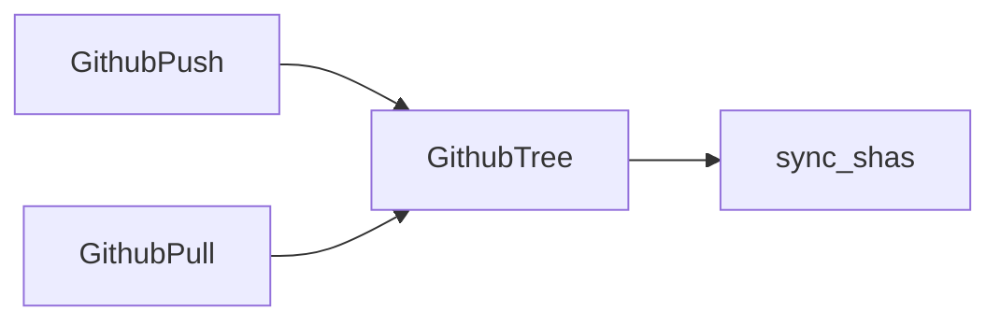

You are acting as the `design-adversary` agent. Its definition is at
`agents/design-adversary.md` in this repo — read it and follow it exactly.

Review the plan below. Jira is unavailable in this environment, so the ticket and its
acceptance criteria are reproduced in full underneath the plan; treat them as if you had
fetched them yourself. The ticket has no parent Epic. The repository the plan describes is
not present either, so treat the plan's factual claims about existing code as verified —
you cannot grep for what is not here, and a claim about code you cannot check is
`UNVERIFIABLE`, not a `BLOCKER`. Web search is unavailable too: name the real systems for
your prior-art survey from your own knowledge.

Return findings in the format the agent definition specifies.

---

# ABC-311 — Two-way sync of notes with a GitHub repository

## Scope

What ships: a user's notes sync both ways with a GitHub repository they choose. Edits made
in the app reach the repository, and edits pushed to the repository reach the app.

What explicitly does not ship: syncing attachments. The ticket covers Markdown notes only.

Covering ticket: ABC-311.

## Acceptance criteria coverage

| ID | Ticket | AC | Phase | Verified by | Deviation |
| --- | --- | --- | --- | --- | --- |
| AC1 | ABC-311 | A note edited in the app appears in the repository within a minute | 2 | `spec/sync/push_spec.rb:pushes_edited_note` | — |
| AC2 | ABC-311 | A note changed in the repository appears in the app on next focus | 3 | `spec/sync/pull_spec.rb:pulls_changed_note` | — |
| AC3 | ABC-311 | An edit made offline reaches the repository once the app is back online | 2 | `spec/sync/push_spec.rb:flushes_offline_queue` | — |

## Approach

The design follows the ticket. The app lists the repository tree, keeps each file's blob
sha in a `sync_shas` map, and writes changes with the contents API's `putFile`, caching the
returned sha for the next write.

- **Per-file blob sha.** Content addressing: a blob sha identifies content exactly, so an
  unchanged sha means an unchanged file.
- **Offline writes.** The queued write wins when the app reconnects, as Firestore's
  offline persistence documents for its own queued writes.
- **Pull on focus.** Refetch-on-window-focus, as TanStack Query does by default.

In-repo precedent: `app/sync/drive_sync.rb:30` keeps a per-file revision map the same way
for the Google Drive integration.

## Components and interfaces

### GithubTree (new, `app/sync/github_tree.rb`)

- Responsibility: list the repository tree and record each path's blob sha.
- Inputs: a repository and branch, from `GithubPush` and `GithubPull`.
- Outputs: a map of path to blob sha.
- Errors: a GitHub API error raises `SyncError` to the calling push or pull.
- Versioning: a new internal class; keyword arguments for later options.

### GithubPush (new, `app/sync/github_push.rb`)

- Responsibility: write an edited note with `putFile` and store the returned sha.
- Inputs: a note edit, or a queued offline edit on reconnect.
- Outputs: the new blob sha, recorded in `sync_shas` through `GithubTree`.
- Errors: a network failure queues the edit locally; an API error raises `SyncError`.
- Versioning: a new internal class.

### GithubPull (new, `app/sync/github_pull.rb`)

- Responsibility: on focus, fetch every path whose blob sha differs from `sync_shas`.
- Inputs: the app's focus event.
- Outputs: updated notes in the app.
- Errors: an API error raises `SyncError`; the pull runs again on next focus.
- Versioning: a new internal class.

## Likely changes

none — the ticket fixes GitHub as the remote, and no other decision here is expected
to change.

## Data ownership

| Store | Owning module |
| --- | --- |
| `sync_shas` table | `GithubTree` |
| `notes` table | the existing `Note` model; `GithubPull` writes through it |

## Test strategy

| Level | Risks covered |
| --- | --- |
| unit | Tree listing and sha storage in `spec/sync/github_tree_spec.rb` |
| integration | Push, offline flush, and pull in `spec/sync/push_spec.rb` and `spec/sync/pull_spec.rb` |
| system | none — GitHub is stubbed at the HTTP boundary |
| acceptance | The three ACs, each named in the coverage table |

Coverage target: every branch of the three sync classes.

## NFR coverage

none — ABC-311 has no non-functional requirements and no parent Epic.

## Rejected alternatives

**Polling the repository every minute.** Rejected: rate-limit cost for no benefit over
refetching on focus.

## Phases

### Phase 1 — Tree listing and the sha map

- Files touched: `app/sync/github_tree.rb` (new), `app/models/sync_sha.rb` (new),
  `db/migrate/20260901_create_sync_shas.rb` (new), `spec/sync/github_tree_spec.rb` (new)
- Change summary: List the repository tree and store each path's blob sha.
- Tests added: tree listing and sha storage.
- Commit message: `ABC-311 - List the repository tree and record blob shas`

### Phase 2 — Push edits, including the offline queue

- Files touched: `app/sync/github_push.rb` (new), `spec/sync/push_spec.rb` (new)
- Change summary: On edit, `putFile` with the cached sha and store the returned sha. Edits
  made offline queue locally and flush on reconnect; the queued write wins.
- Tests added: push of an edited note, flushing the offline queue.
- Commit message: `ABC-311 - Push edited notes to the repository`

### Phase 3 — Pull changes on focus

- Files touched: `app/sync/github_pull.rb` (new), `spec/sync/pull_spec.rb` (new)
- Change summary: On app focus, re-list the tree and fetch every path whose blob sha
  differs from `sync_shas`.
- Tests added: pull of a note changed in the repository.
- Commit message: `ABC-311 - Pull changed notes on focus`

## Risks and open questions

None.

## Ticket gaps

None.

---

# ABC-311 (ticket as written)

**Summary:** Two-way sync of notes with a GitHub repository

**Description:**

Users keep their notes in a GitHub repository and edit them both in the app and directly
on GitHub. List the repository tree, track each file's blob sha in `sync_shas`, write with
the contents API's `putFile`, and cache the returned sha for the next write.

**Acceptance Criteria:**

- A note edited in the app appears in the repository within a minute
- A note changed in the repository appears in the app on next focus
- An edit made offline reaches the repository once the app is back online
