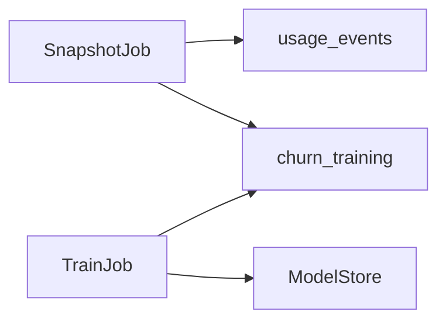

You are acting as the `design-adversary` agent. Its definition is at
`agents/design-adversary.md` in this repo — read it and follow it exactly.

Review the plan below. Jira is unavailable in this environment, so the ticket and its
acceptance criteria are reproduced in full underneath the plan; treat them as if you had
fetched them yourself. It has no parent Epic. The repository the plan describes is not
present either, so treat the plan's factual claims about existing code as verified — you
cannot grep for what is not here, and a claim you cannot check is `UNVERIFIABLE`, not a
`BLOCKER`. The project the plan belongs to — not this repository — has `data-ml` and no
other discipline in its `disciplines`, so the plan carries no `Threat model`.

Return findings in the format the agent definition specifies.

---

# ABC-412 — Retrain the churn model weekly on the last 90 days

## Scope

What ships: a weekly job that rebuilds the `churn_training` dataset from the last 90 days
of `usage_events`, retrains the churn model on it, and promotes the new model only when its
recall on the fixed holdout set `churn-holdout-2026q3` is at least 0.80.

What explicitly does not ship: online scoring changes, which keep loading whichever model is
promoted, and any change to how `usage_events` is collected.

Covering ticket: ABC-412.

## Acceptance criteria coverage

| ID | Ticket | AC | Phase | Verified by | Deviation |
| --- | --- | --- | --- | --- | --- |
| AC1 | ABC-412 | The weekly job writes a `churn_training` snapshot of the last 90 days | 1 | `tests/training/test_snapshot.py:test_window` | — |
| AC2 | ABC-412 | A model with holdout recall >= 0.80 is promoted | 2 | `tests/training/test_promote.py:test_promotes` | — |
| AC3 | ABC-412 | A model with holdout recall < 0.80 is not promoted and the old one stays | 2 | `tests/training/test_promote.py:test_keeps_old` | — |

## Approach

Surveyed: TFX's pipeline (ExampleGen snapshots the data, Trainer fits, Evaluator gates
promotion on a metric threshold against a fixed evaluation split, Pusher promotes only a
blessed model), MLflow's Model Registry (a candidate version moves to Production only after
validation), and SageMaker Pipelines' condition step. All three gate promotion on a metric
over fixed evaluation data. This plan follows TFX's Evaluator-then-Pusher shape.

In-repo precedent: `jobs/nightly_report.py:12` schedules work through the same scheduler.

## Components and interfaces

### SnapshotJob (new, `jobs/snapshot.py`)

- Responsibility: write the week's `churn_training` snapshot.
- Inputs: `usage_events` rows from the last 90 days.
- Outputs: one Parquet snapshot per run.
- Errors: an empty window fails the run and promotes nothing.
- Versioning: the snapshot schema is the column list in `jobs/snapshot.py`.

### TrainJob (new, `jobs/train.py`)

- Responsibility: train on the snapshot and promote a model that passes the gate.
- Inputs: the newest snapshot and the holdout set `churn-holdout-2026q3`.
- Outputs: a model in `ModelStore`, promoted or not.
- Errors: recall below 0.80 keeps the promoted model and logs the score.
- Versioning: each model is stored under its training date.

## Likely changes

- The promotion threshold — hidden behind `TrainJob`.

## Data ownership

| Store | Owning module |
| --- | --- |
| `churn_training` snapshots | `SnapshotJob` |
| `ModelStore` | `TrainJob` |

## Test strategy

| Level | Risks covered |
| --- | --- |
| unit | The 90-day window in `tests/training/test_snapshot.py`; the gate in `tests/training/test_promote.py` |
| integration | none — the scheduler is exercised by the existing `nightly_report` tests |
| system | none — a full retrain is a manual check |
| acceptance | The three ACs, each named in the coverage table |

Coverage target: 100% branch coverage of both jobs.

## NFR coverage

| Ticket | NFR | Design element |
| --- | --- | --- |
| ABC-412 | NFR1 | TrainJob: the recall gate against `churn-holdout-2026q3` |

## Rejected alternatives

**Retraining on every new event.** Rejected: a weekly window keeps the snapshot
reproducible, which the holdout comparison needs.

## Phases

### Phase 1 — Snapshot the training window

- Files touched: `jobs/snapshot.py` (new), `jobs/schedule.py`, `tests/training/test_snapshot.py` (new)
- Change summary: a weekly job writing the last 90 days of `usage_events` to a dated snapshot.
- Tests added: the window boundary, and an empty window failing the run.
- Commit message: `ABC-412 - Snapshot the churn training window weekly`

### Phase 2 — Train and gate promotion

- Files touched: `jobs/train.py` (new), `jobs/schedule.py`, `tests/training/test_promote.py` (new)
- Change summary: train on the newest snapshot, score recall on the holdout set, promote at 0.80 or above.
- Tests added: promotion at 0.80, and the old model kept below it.
- Commit message: `ABC-412 - Promote a retrained churn model only above the recall gate`

## Risks and open questions

None.

## Ticket gaps

None.

---

# ABC-412 (ticket as written)

**Summary:** Retrain the churn model weekly on the last 90 days

**Acceptance Criteria:**

- A weekly job writes a `churn_training` snapshot of the last 90 days
- A model with holdout recall >= 0.80 is promoted
- A model with holdout recall < 0.80 is not promoted and the old one stays

**Non-functional requirements:**

- NFR1: Recall >= 0.80 on holdout: churn-holdout-2026q3
